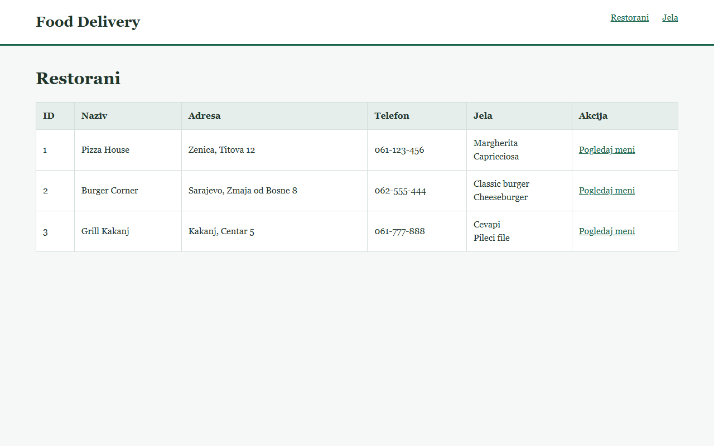
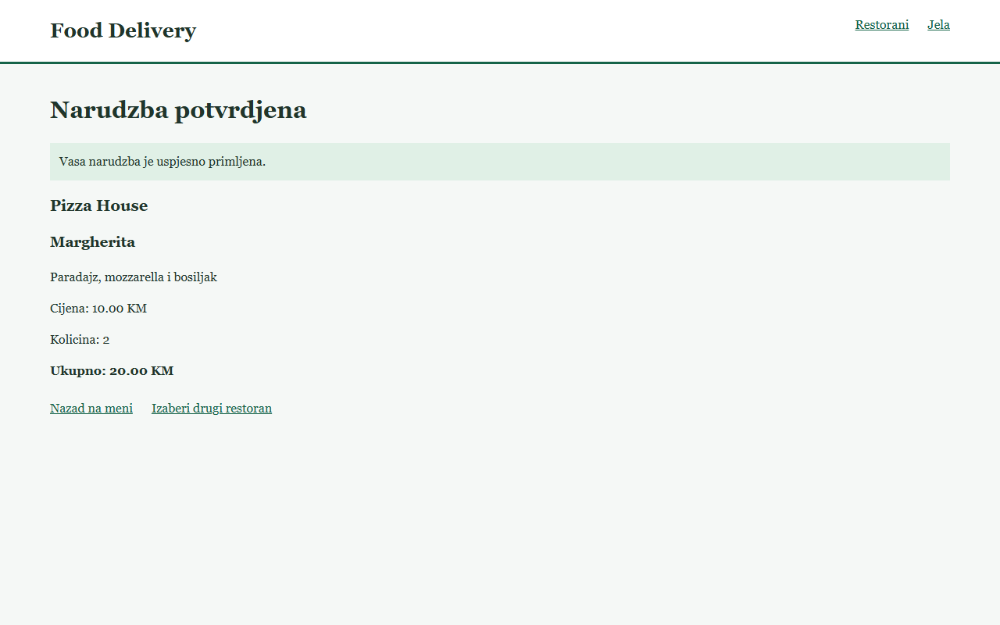

# Food Delivery: Restaurant & Meal

 Lab vjezba 1, Web programiranje.

## Clanovi
- Eman Palavra, 518
- Emin Nusinovic, 489

## Modeli i relacija
Restaurant: id, name, address, phone, meals.
Meal: id, name, description, price, restaurant.
Lista restorana prikazuje njegova jela. 

Lista jela prikazuje restoran kojem jelo pripada.

## Pokretanje
Potreban je JDK 25 ili noviji. Prvo pokretanje zahtijeva internet za Maven zavisnosti.
Otvoriti u IntelliJ IDEA folder koji sadrzi pom.xml:

`Food Delivery_ Restaurant & Delivery/Food-Delivery-Restaurant-Delivery`.

Adresa: http://localhost:8080

## Rute i akcija
- GET /: preusmjeravanje na restorane.
- GET /restaurants (ili /a): lista restorana i njihovih jela.
- GET /meals (ili /b): lista jela i pripadajucih restorana.
- GET /meals?restaurantId={id}: meni odabranog restorana.
- GET /restaurants/action/{id}?mealId={mealId} (ili /a/action/{id}): pregled jela i potvrda narucivanja.
- POST na istu adresu: provjera jela i kolicine, obracun ukupne cijene i preusmjeravanje na potvrdu.

Akcija: izabrati restoran preko Pogledaj meni, odabrati Naruci pored jela,
unijeti kolicinu 1-20 i kliknuti Potvrdi narudzbu.
Potvrda prikazuje restoran, jelo, kolicinu i ukupnu cijenu.
Neispravna kolicina prikazuje poruku. Nepostojeci restoran ili jelo vraca HTTP 404.
Jelo drugog restorana nije moguce naruciti kroz pogresan restoran.
Ovo je demonstracija narucivanja: nema placanja, stvarne dostave ni trajne historije narudzbi.
Potvrda je privremena poruka nakon POST zahtjeva; osvjezavanje je ne salje ponovo.
Podaci su u DemoData.java, bez baze, i resetuju se restartom aplikacije.

## Podjela rada
Plan odgovornosti koji clanovi trebaju potvrditi stvarnim doprinosima:
- Eman: Restaurant, ruta i lista restorana.
- Emin: Meal, ruta i lista jela.
- Zajednicki: DemoData, akcija, testiranje i dokumentacija.

Automatska dorada ne predstavlja dokaz odvojenih studentskih doprinosa.

## Screenshot

